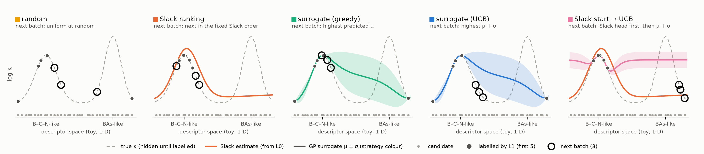
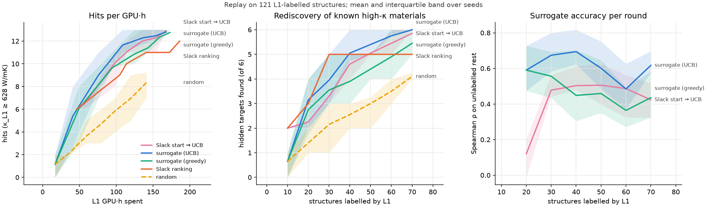
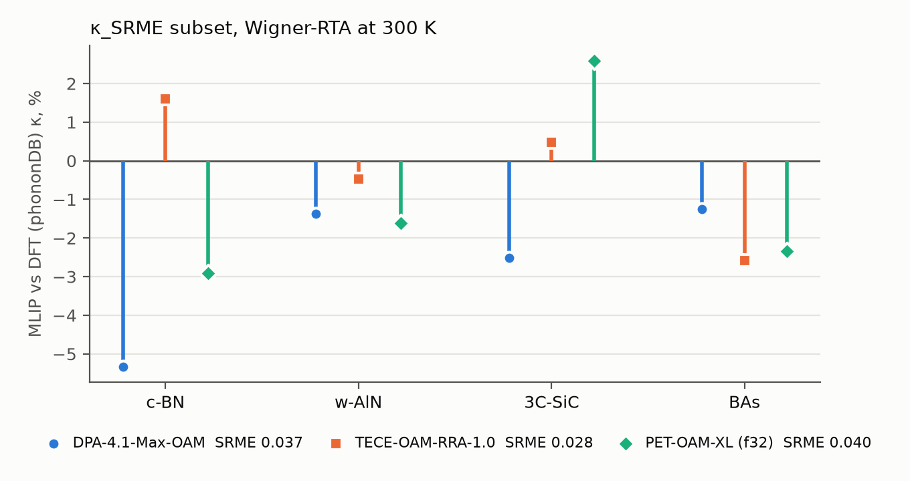
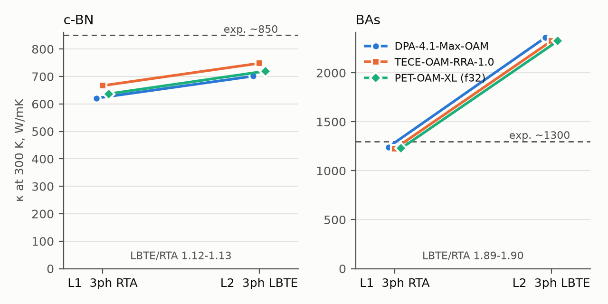

# 高导热材料的闭环搜索

MLIP × 结构枚举 × agent：一个会从自己算过的结果里学习、每一步都可审查的高 κ 材料搜索框架。

> 这是 `loop` 分支。`main` 分支记录的是之前的单向漏斗（MatterGen / AIRSS / CrystalFormer → 弛豫 → E_hull → L0 → L1），完整过程见 [docs/search_log.md](docs/search_log.md)。

## 为什么改成闭环

`main` 上的漏斗跑通了，但每一批都和上一批无关：

- **没有回流**：下游的 L0 / L1 结果不影响下一批生成什么、先算什么。三种原理完全不同的生成器反复收敛到同一批结构（AlSiCN sg 160 被找到三次），L1 κ 在 195–240 W/mK 封顶。
- **门槛和目标冲突**：高 κ 的致密 sp³ 相相对层状相本来就是亚稳的。按 MP 凸包，金刚石在凸包以上 0.138 eV/atom，c-BN 0.077，BAs 0.080，B–C–N 三元最低 0.173。「E_hull ≤ 0.1 且 MP 里没有」留下的基本只有四面体二元化合物的有序合金，而它们的 κ 低于端元。
- **奖励信号是平的**：命中定义为超过 c-BN，命中数为 0，候选之间的差距和模型误差相当，没有可以学习的信号。

闭环把问题换成：**在固定的候选池上，一个从已算结果里学习的选样策略，能比固定规则和随机更快地找到高 κ 结构吗？** 这个问题无论有没有找到新材料都有可报告的结果。

## 循环

```
候选池 ──► 代理模型挑一批 ──► 弛豫 → L0（FC2 描述符）→ L1（3ph κ）
   ▲                                          │
   │                                          ▼
   └── 新的稳定结构做元素替换 ◄── 重训代理模型（L0 描述符 → L1 κ）
```

1. **候选池**：确定性生成的小原胞结构（见下）。
2. **每一轮**：代理模型按预测的 κ 和不确定度挑一批结构，跑 L0、L1。
3. **结果回流两处**：
   - 重训代理模型，修正 Slack 估计的系统偏差（`main` 分支那批彼此相近的候选上，Slack 和 L1 的 Kendall τ 只有 0.36）；
   - 新的 L0 稳定结构作为原型，做同族元素替换，加进下一轮的候选。
4. **目标是连续量**：κ 和 E_hull 一起报告，E_hull 不再是硬门槛。

**先全算，再回放**：先把整个池子的 L0 和一大批 L1 算完，然后在 `replay` 模式下让[五种选样策略](#五种选样策略)各跑多次（不同随机种子）。这样曲线有误差棒，也不依赖集群状态。

**要展示的三条曲线**：
- **重发现**：池里藏着 c-BN、BAs、BP、SiC、金刚石和阳性对照 R3m-BNC₂，看每种策略第几轮找到它们；
- **代理模型逐轮变准**：与 L1 排序的相关性随轮数的变化；
- **单位成本**：每找到一个 L0 稳定结构、一个高 κ 结构花多少 GPU·h。

## 五种选样策略

每个结构的 L1 要几到十几 GPU·h，每一轮只能算几个，策略决定先算哪几个。五种策略用同一个候选池、同样的每轮预算。后三种共用一个高斯过程代理模型（`src/mga/loop/surrogate.py`：Matern-5/2 ARD 核加白噪声，输入 L0 描述符，输出 log₁₀ κ_L1，每轮用全部已有标签重训），它给每个候选一个预测值 μ 和不确定度 σ。



*一维玩具示意，不是真实数据（`scripts/strategy_schematic.py`）。虚线是隐藏的真实 κ：左边的宽峰 Slack 估得准（类比 B–C–N），右边更高的峰它漏掉了（类比 BAs）。每格显示一种策略标完第一批之后，下一批会选哪 3 个（空心圈）。GP 的拟合和选择都是用项目里的 `Surrogate` 和 `rank` 实际算出来的。*

| 策略 | 怎么选下一批 | 优势 | 局限 |
|---|---|---|---|
| `random` | 从没算过的结构里均匀随机抽 | 没有任何偏向，是衡量其他策略的下限 | 不用任何信息，命中率就是池子里高 κ 结构的比例 |
| `slack` | 按 L0 的 Slack 估计从高到低，顺序一开始就定死 | 不需要任何 L1 标签，开局就能靠物理先验命中 | 不学习：Slack 系统性低估的结构（如声学–光学 gap 大的 BAs）要排到很后面 |
| `greedy` | 第一批随机；之后选 GP 预测 μ 最高的 | 从 L1 结果里学习，能修正 Slack 的偏差 | 只挑自己认为好的地方，没把握的区域不去看，容易困在已知的峰上 |
| `ucb` | 同 greedy，但按 μ + β·σ 选（β = 1） | 兼顾利用和探索：预测高或者没把握的都会被选，训练集更分散，代理模型学得更准 | 一部分预算花在探索上；随机冷启动时，开局慢于 Slack |
| `slack_ucb` | 第一批取 Slack 排名最前的；之后同 ucb | 物理先验负责冷启动，代理模型负责纠偏：开局和 Slack 一样准，又能较早找到 Slack 漏掉的结构 | 第一批集中在同一类结构上，特征覆盖窄，后期把高 κ 结构找全比纯 ucb 慢 |

`slack_ucb` 和 `ucb` 只有冷启动不同。真实轮次（`scripts/loop_round.py`）里已经有分层抽样得到的 L1 标签，两者的排序完全一样。

## 当前进展

> 截至 2026-11-17。每一步由谁决定（规则 / 科学模型 / 人 / agent）见 [docs/agent_roles.md](docs/agent_roles.md)。

### 总览

| 阶段 | 选法 | 结构数 | 有 κ_L1 | 命中（≥ 538 W/mK） | L1 GPU·h |
|---|---|---|---|---|---|
| 候选池 | 确定性枚举 | 804 | — | — | — |
| L0 稳定 | 无虚频 | 314 | — | — | — |
| 初始样本 `loop.l1.v1` | 化学体系 × Slack 三分位分层抽样 | 118 | 91 | 10（11 %） | 139 |
| 第 1 轮 `loop.round.r1` | GP + UCB | 10 | 10 | 6 | 79 |
| 第 2 轮 `loop.round.r2` | GP + UCB | 10 | 10 | 1 | 19 |
| 第 3 轮 `loop.round.r3` | GP + UCB，FC2 ≤ 360 原子（L40S） | 10 | 10 | 1 | 20 |
| 第 3 轮补充 `loop.round.r3.a100` | UCB 第 2、3 名，超胞太大，放 A100 | 2 | 2 | 2 | 38 |
| 第 4 轮 `loop.round.r4` | 最后 2 个 μ 超过命中线的候选 | 2 | 2 | 1 | 7 |

- **GP 选样的命中率约是分层样本的 3 倍**：4 轮共 34 个结构、11 个命中（32 %），分层初始样本是 11 %。不算第 3 轮补充的 2 个大胞，是 9/32（28 %）。
- **但每个命中花的 GPU·h 差不多**：初始样本约 14 GPU·h / 命中，GP 轮次约 15。GP 选中的多是致密 B–C–N 大晶胞，单个就贵。闭环省下的是 L1 的次数，不是 GPU·h。
- **命中阈值**：初始样本前 81 个标签的 90 % 分位（537.7 W/mK），定下后不再改动。
- **κ 最高的结构**：314 个 L0 稳定结构里已有 125 个 L1 标签。最高的是金刚石 1600、BAs 1255，其后是闭环找到的 BC₆N-dd97 902、BC₆N-ed32 894、BC₆N-07a2 887（单位 W/mK）。L2（LBTE）下 dd97、07a2、ed32 分别是 1014、968、962，见[下文](#l2用-lbte-复核前几名)。
- **这一轮搜索可以收尾**：用 125 个标签重训后，候选池里已经没有 μ 超过命中线的结构；扩池只得到低 κ 的 Al–Si–N 和 Si 结构。

### 候选池

`scripts/build_pool.py` 确定性生成，没有随机结构，限定在 16 个化学体系、原胞 ≤ 8 原子：

| 来源 | 数量 | 内容 |
|---|---|---|
| `enum` | 447 | 闪锌矿、纤锌矿、岩盐超胞上的有序占位，按固定氧化态电荷平衡 |
| `bcn` | 570 | 同样的超胞上 B、C、N 占所有位点，n(B) = n(N) |
| `subst` | 135 | 项目里 L0 稳定的结构和 MP 结构做同族元素替换 |
| `known` | 57 | MP 结构（E_hull ≤ 0.3），作为锚点 |

- 占位先按母格超胞的空间群约化，再用近邻距离签名和 StructureMatcher 去重，共 1209 个（集合 `loop.pool.v1`）。
- B–C–N 三元原来占 605 个，按化学式轮流、每个化学式内对称性从高到低保留到 200 个（`scripts/trim_pool.py`），否则回放曲线会被一个体系主导。**最终 804 个**（集合 `loop.pool.v1.bcn200`）。
- 池里有 157 个 κ_SRME 化学式的结构，**只作为隐藏的重发现目标**：代理模型学的是循环自己算出的 L1 值，这些结构不进任何 MLIP 训练或调参数据。

### L0：稳定性和描述符

- 628 个结构跑完 L0，**314 个声子稳定**（集合 `loop.pool.v1.bcn200.l0stable.w10`），310 个有虚频，4 个失败，共 23.6 GPU·h。
- **FC2 超胞用 10 Å**：14 Å 下致密 B–C–N 的超胞（≥ 399 原子）在 44 GB 卡上显存不够。两种宽度都算过的 62 个结构里，59 个稳定性判断一致，Slack 的 Spearman 0.975。
- **Slack 的盲区**：隐藏目标在 Slack 里的排名是金刚石第 2、c-BN 第 13、SiC 第 28 起、BP 第 47，**BAs 只排第 175**。Slack 公式里没有声学–光学能隙，这正是代理模型要纠正的地方。

### L1 标签

**协议**：3ph Wigner-RTA，300 K，FC3 8 Å。FC2 宽度的选择：

| FC2 宽度 | 用在哪里 | 原因 |
|---|---|---|
| 14 Å | 初始样本 | phononDB 的默认值 |
| 12 Å | 选样轮次 | 收敛测试见下 |
| 10 Å | 12 Å 下 720 原子的超胞 | A100 80 GB 也放不下 |

- **收敛测试**（κ_L1，FC2 10 / 12 / 14 Å，单位 W/mK）：

  | 结构 | 10 Å | 12 Å | 14 Å |
  |---|---|---|---|
  | c-BN | 635 | 651 | 628 |
  | BAs | 1176 | 1209 | 1255 |
  | BC₂N | 530 | 536 | 540 |
  | 金刚石 | 1616 | 1611 | 1600 |

  12 Å 和 14 Å 相差 4 % 以内，10 Å 在 6 % 以内。各宽度的结果按不同的协议哈希分别存放，都作为标签使用。
- **GPU 分配**：FC2 超胞 ≤ 360 原子放 L40S（44 GB），≤ 672 原子放 A100（80 GB）。
- **目标的 κ_L1**（W/mK）：金刚石 1600、BAs 1255、c-BN 628、R3m-BC₂N 540、BP 377、3C-SiC 344。
  - MLIP 普遍比实验低 20–35 %。
  - BAs 和实验接近，是两种误差抵消的结果：只算三声子散射会高估，MLIP 声子软化会低估。

**初始样本**：从 314 个 L0 稳定结构中，按化学体系 × Slack 三分位分层抽 118 个（`scripts/sample_l1.py`）。抽样不偏向任何策略，6 类目标强制入选。118 个的结果：

| 状态 | 数量 | 说明 |
|---|---|---|
| 有 κ_L1 | 91 | 模式求和检查都过，没有 κ ≤ 0 |
| 显存不足 | 15 | FC2 超胞太大，A100 80 GB 也放不下；几乎全是大晶胞 B–C–N，作缺失标签 |
| 14 Å 下有虚频 | 7 | 在 10 Å 的 L0 里是稳定的，FC2 宽度对稳定性判断有影响 |
| 弛豫后对称性破缺 | 1 | |
| 超时 | 4 | 2 个 BPC₂、2 个 BPC₆ 在同一个作业里串行，超过 24 h；这类结构 κ 很低（后来实测的一个 BPC₆ 是 20 W/mK），没有重算 |

### 选样策略的回放验证

**设置**（`scripts/loop_replay.py --name final121`）：
- 回放用全部 121 个 L1 标签（第 3 轮补充和第 4 轮的 4 个是之后才出的）。
- κ_L1 在这 121 个里的前 10 %（≥ 628 W/mK）算命中，共 13 个。这个阈值高于真实轮次用的 538，因为后来加进的标签里高 κ 的多。
- 第一批 10 个，之后每轮 10 个（和真实轮次一样），共 6 轮，20 个随机种子。
- 池里藏着 6 类目标：金刚石、c-BN、BAs、BP、SiC、R3m-BC₂N。

| 策略 | 标 10 个时命中 | 20 | 30 | 70 | 70 个时找到的目标（共 6 类） | 找到 BAs 要标几个（中位数） | 70 个时 GPU·h | 代理模型 Spearman（30 / 70 个） |
|---|---|---|---|---|---|---|---|---|
| `random` | 1.2 | 2.1 | 3.7 | 8.4 | 4.1 | 45（14/20 个种子找到） | 141 | — |
| `slack` | **6** | **9** | 10 | 12.0 | 5.0 | 没找到（0/20） | 186 | — |
| `greedy` | 1.2 | 6.1 | 9.7 | 12.8 | 5.5 | 40（17/20） | 173 | 0.56 / 0.44 |
| `ucb` | 1.2 | 5.4 | 9.0 | 12.8 | **6.0** | 40（**20/20**） | 168 | **0.67 / 0.62** |
| `slack_ucb` | **6** | 6.4 | **10.1** | **12.9** | 5.9 | 40（19/20） | 168 | 0.48 / 0.42 |



- **代理模型有用**：标到 30 个时，三种 GP 策略找到的命中是随机的 2.5–2.8 倍。
- **Slack 开局最强，但会停住**：前 20 个标签里就有 9 个命中，之后停在 11–12 个。BAs 在 Slack 里排得太后，70 个标签以内一次都没找到。GP 策略后期继续上涨，花的 GPU·h 还更少（Slack 偏爱大晶胞）。
- **ucb 的代理模型最准**：在没标的结构上 Spearman 0.6–0.7。greedy 和 slack_ucb 只在已知的峰附近选，训练集覆盖窄，只有 0.4–0.5。ucb 也是唯一 20 个种子全部找到 BAs、并把 6 类目标找全的策略。
- **slack_ucb 两头都占**：开局和 Slack 一样，70 个时命中数最多；代价是代理模型不如纯 ucb 准。真实轮次已经有初始样本，它和 ucb 的排序完全一样。
- **和初测一致**：之前用前 81 个标签、每轮 5 个做的初测（[图](docs/figures/loop_replay_prelim81.png)）得到同样的排序：Slack 开局强但漏掉 BAs，GP 策略约是随机的 2 倍。
- **局限**：
  - 121 个标签里有 30 个是 GP 选出来的，高 κ 的比例高于原始候选池，所以命中数的绝对值偏乐观，策略之间的相对比较更可靠；
  - `slack_ucb` 的第一批是固定的，种子之间的差别只来自 GP 拟合，方差被低估了；
  - 显存不足的结构正好在高 κ 的大晶胞 B–C–N 区域，这部分缺标签。

### 选样轮次的结果

**每一轮怎么选**（`scripts/loop_round.py`）：
1. 用全部 L1 标签重训 GP，按 μ + σ 排序；
2. 每个化学式最多 2 个，还在算的也计入；
3. 已算过和正在算的结构排除；
4. 提交前报告结构数和预计 GPU·h，由用户批准。

**全部 34 个结构**（κ 单位 W/mK，μ 是选样时 GP 的预测；3+ 是第 3 轮补充的大胞）：

| 结构 | 轮次 | μ | κ_L1 |
|---|---|---|---|
| BC₆N-dd97 | 1 | 967 | **902** |
| BC₆N-ed32 | 3 | 868 | **894** |
| BC₆N-07a2 | 2 | 1059 | **887** |
| BC₂N-1a47 | 1 | 634 | **725** |
| BC₆N-a761 | 1 | 1322 | **699** |
| BC₂N-c3fe | 1 | 871 | **657** |
| BC₂N-bd92 | 3+ | 622 | **626** |
| B₃C₂N₃-89b4 | 1 | 661 | **624** |
| BC₂N-54d3 | 3+ | 622 | **618** |
| BC₆N-ad76 | 4 | 677 | **568** |
| BN-0448 | 1 | 578 | **547** |
| BCN-f80f | 1 | 587 | 529 |
| BC₂N-7a22 | 2 | 595 | 519 |
| BC₆N-a01b | 4 | 576 | 510 |
| BN-5cf8 | 1 | 226 | 388 |
| BC₇-c9dd | 2 | 914 | 375 |
| BeCN₂-fea4 | 2 | 434 | 329 |
| B₄As₃P-b407 | 3 | 299 | 329 |
| B₂AsP-ef16 | 1 | 548 | 319 |
| BeC₅N₂-d029 | 3 | 309 | 300 |
| BN-df2e | 2 | 421 | 270 |
| BeCN₂-fc39 | 3 | 253 | 268 |
| SiC₇-d6d6 | 3 | 334 | 241 |
| BPC₂-3676 | 3 | 284 | 232 |
| B₃As₂P-d918 | 2 | 701 | 197 |
| B₄As₃P-7abe | 2 | 551 | 194 |
| AlC₆N-5fb1 | 3 | 286 | 192 |
| BP-c550 | 1 | 452 | 180 |
| BC₅-1f95 | 2 | 413 | 143 |
| BN-d645 | 3 | 276 | 127 |
| BN-6712 | 3 | 87 | 40 |
| BPC₆-6c62 | 2 | 85 | 20 |
| AlC₂N-d643 | 2 | 206 | 8 |
| GaN-bcf5 | 3 | 65 | 6 |

**观察**：
- **GP 的作用在于选，不在于排**：在每轮选中的结构内部，GP 排序的 Spearman 第 2、3 轮是 0.83、0.88，和 Slack 差不多。
- **探索很快补上了盲区**：
  - 第 2 轮的探索点偏差很大：B–As–P 有序合金预测 550–700，实际约 195；AlC₂N 预测 206，实际 8。
  - 这些点进训练集之后，第 3 轮的预测准多了：|log₁₀(μ/κ)| 的中位数从 0.42（约差 2.6 倍）降到 0.06（约 15 %），例如 B₄As₃P 预测 299、实际 329。
  - 这正是 UCB 的设计意图：一部分预算用来补代理模型的盲区，补上的点马上进下一轮训练。
- **外推最远的被高估**：μ 最高的结构离训练数据最远，例如第 1 轮 BC₆N-a761 预测 1322、实际 699，第 4 轮两个 BC₆N 预测 677、576，实际 568、510。
- **大胞补充值得**：BC₂N-54d3、BC₂N-bd92 预测 622，实际 618、626，两个都命中；代价是在 A100 上每个约 19 GPU·h。

### L2：用 LBTE 复核前几名

L1 用的是弛豫时间近似（RTA）。L2 在同一套力常数上直接解线性化玻尔兹曼方程（LBTE，Wigner 输运），看 RTA 的排序是否可靠。每组按 L1 的 FC2 宽度单独提交，这样力常数缓存的哈希一致，不用重算力常数（集合 `loop.l2.v1.w10/w12/w14`）。

| 结构 | κ_L1（RTA） | κ_L2（LBTE） | LBTE / RTA | GPU·h |
|---|---|---|---|---|
| 金刚石 | 1600 | 2054 | 1.28 | 0.04 |
| BAs | 1255 | 2392 | **1.91** | 0.01 |
| c-BN | 628 | 703 | 1.12 | 0.04 |
| **BC₆N-07a2** | 887 | **968** | 1.09 | 11.5 |
| **BC₆N-ed32** | 894 | **962** | 1.08 | 1.5 |
| BC₄N-a54a | 794 | 890 | 1.12 | 0.27 |
| R3m-BC₂N（阳性对照） | 774 | 861 | 1.11 | 1.6 |
| BC₂N-1a47 | 726 | 786 | 1.08 | 0.18 |
| **BC₆N-dd97** | 902 | **1014** | 1.12 | 14.5 |

- **参考物质和 S0 一致**：c-BN +12 %，BAs +91 %（S0 是 +12–13 % 和 +89–90 %）。BAs 的声学–光学能隙大，Normal 过程占主导，RTA 把它们当成热阻，所以低估得多。
- **B–C–N 候选只差 8–12 %，排序基本不变**：dd97 仍然第一（1014），只有 07a2 和 ed32 换了位置，两者相差 0.6 %。相干项 κ_C 都小于 0.3 W/mK。所以 L1 用 RTA 给这类材料排序是够的。
- **成本由碰撞矩阵决定**：07a2 对称性低，有 617 个不可约 q 点，碰撞矩阵约 31.6 GB，用了 11.5 GPU·h；dd97 有 580 个（27.9 GB），14.5 GPU·h；ed32 只有 279 个，1.5 GPU·h。估 L2 成本要看不可约 q 点数，不能只看原子数。

### 计算成本和工程约束

**L1 成本模型**：GPU·h ≈ 3.55×10⁻⁸ × FC3 位移数 × FC3 超胞原子数^1.76。
- 用 98 个实测耗时拟合，10–90 % 的结构落在预测值的 0.69–1.41 倍内。
- 对原子数是超线性的，因为集群上 DPA 的近邻搜索是稠密的 O(N²)。
- 之前按原胞原子数线性外推：初始样本预估 66 GPU·h，实际约 150；对 384 原子的 FC3 超胞低估约 3 倍。

| 计算 | GPU·h | 说明 |
|---|---|---|
| 对称约束精弛豫 | 约 0.005 | |
| L0 FC2 描述符（10 Å） | 约 0.04 | 628 个结构共 23.6 GPU·h |
| L1 3ph Wigner-RTA | 0.01–32 | 128 原子的 FC3 超胞约 2–4，384 原子的约 16–32；125 个标签共 302 GPU·h |
| L2 LBTE | 0.01–14.5 | 取决于碰撞矩阵大小，9 个结构共 30 GPU·h |

**作业约束**：
- **一个作业只放一个结构**：多个大结构串行会超过 24 h 时限，一次全丢。
- **大胞延长时限**：预计超过 24 h 的大胞，提交时把时限设为 3 天。
- **SSH 断线**：笔记本休眠后 SSH 断开，jobflow-remote 的 runner 会挂住。设了 `connect_timeout` 和 keepalive 后少了很多，但偶尔还有 SSH banner 超时，把集群上正常运行的作业标成 `REMOTE_ERROR`，用 `jf job retry` 恢复。

### 下一步

1. **换一种方式扩池**：这个候选池里已经没有 μ 超过命中线的结构。对命中结构做同族替换（`scripts/grow_pool.py`）只得到低 κ 的 Al–Si–N 和 Si 结构，没有新的 B–C–N。要继续找，得换生成方式（例如更大的原胞、以 κ 为条件的生成模型），而不是在这个池子里再跑几轮。
2. **确认前几名不是 MLIP 的假象**：BC₆N-07a2、ed32、dd97 做 L3（3+4ph）和 DFT（L4）验证。

## 之前的结论（`main` 分支，详见 search_log）

- **S0 校准**：c-BN、w-AlN、3C-SiC、BAs 上，三个委员会模型相对 phononDB 的偏差都在 ±5.5 % 以内，SRME 0.028–0.040；移植的 κ 协议和 Matbench Discovery 排行榜上同一模型的结果相差不超过 2.4 %。

  

- **L1 → L2**：LBTE 让 c-BN 的 κ 提高 12–13 %，BAs 提高 89–90 %。只算 3ph 时 BAs 被高估是已知现象，需要四声子散射修正（Feng, Lindsay & Ruan, [PRB 96, 161201 (2017)](https://doi.org/10.1103/PhysRevB.96.161201)）。

  

- **生成器对比**：MatterGen、AIRSS、CrystalFormer CSP 在 E_hull ≤ 0.1 上的命中率都是百分之几，而且收敛到同一批结构。L1 前 9 名都在 195–240 W/mK，DPA 和 TECE 一致（Kendall τ = 0.85）。
- **MLIP 会让生成的结构坍缩**：原子靠得太近时 DPA 的排斥力不够，E_hull 可以低到 −210 eV/atom。现在有三道防线：生成时的最短间距、E_hull 下限、弛豫后的最短间距检查。
- **Slack 只能当门槛**：它对微小的对称性破缺很敏感，和 L1 的排序相关性弱（τ = 0.36）。这是闭环里用代理模型替代它的原因。

## 计算级别：精度逐级提高

| 级 | 内容 | 工具状态 |
|---|---|---|
| L0 | FC2 描述符：虚频、声学–光学 gap、加权相空间、群速度、Grüneisen、Slack 估计 | 已有 |
| L1 | 3ph Wigner-RTA κ（κ_SRME 协议），力常数存入缓存 | 已有 |
| L2 | LBTE 直接解，读 L1 的力常数缓存 | 已有 |
| L3 | MLIP 四阶力常数（随机位移 + symfc）→ FourPhonon，3+4ph κ | 已有，闭环里暂不用 |
| L4 | DFT | 已有，闭环里暂不用 |

主力 MLIP 是 DPA-4.1-Max-OAM；TECE-OAM-RRA 和 PET-OAM-XL 作为委员会，只在复核时使用。

## 设计原则

- **分工**：工具负责「怎么算」，默认参数都写在工具里，每个都注明出处；agent 负责「算什么、信不信」。
- **记录**：每次调用写一条 JSON 记录（`runs/<run_id>/records/`），包括参数及来源、决定由谁做出（`agent` / `human`）、输入和输出。闭环的记录在 `runs/loop-v1/`。
- **人工关口**：提交 VASP 和开始微调之前，agent 必须停下来；审批只能由人在终端里完成。
- **同一口径**：MLIP 的 κ 移植自 κ_SRME 官方实现（位移 0.03 Å、MS-SMM19、noNAC、phono3py 3.30.0），结果能和 Matbench Discovery 排行榜直接比较。
- **防泄漏**：κ_SRME 的 103 个测试条目对应 70 个化学式，这些化学式的所有多形体及其扰动后代都不能进入训练、回放或调参数据。

## 四个 MCP server

| server | 作用 | 主要工具 |
|---|---|---|
| `mga-structures` | 结构导入、过滤、去重、新颖性和泄漏检查 | `import_structures` `filter_structures` `deduplicate` `check_novelty` `check_benchmark_leakage` |
| `mga-mlip` | MatterGen 生成；MLIP 弛豫、声子和 κ；L0 / L2 / L3 各级计算；收敛检查 | `submit_mlip_relax` `submit_mlip_fc2_descriptors` `submit_mlip_phonon_kappa` `submit_mlip_kappa_lbte` `submit_mlip_fc4_fourphonon` `submit_mlip_convergence` |
| `mga-dft` | VASP 输入预览、成本估计、审批单、提交 | `preview_vasp_inputs` `estimate_vasp_cost` `request_vasp_submission` `submit_vasp` |
| `mga-analysis` | 作业状态、取回结果、E_hull、κ_SRME、模型分歧；预算账本和升级策略基线 | `job_status` `fetch_results` `compute_ehull` `model_disagreement` `budget_ledger` `escalation_baseline` `query_records` |

运行模式用环境变量 `MGA_MODE` 切换：

| 模式 | 提交类工具的行为 |
|---|---|
| `dry_run`（默认） | 构建作业、校验参数、写记录，**不提交** |
| `live` | 通过 jobflow-remote 提交到集群，需要先配好 MongoDB 和 jobflow-remote，见 [plan §7](docs/mcp_servers_plan.md) |
| `replay` | 只返回缓存的结果，用来做可复现的策略比较；VASP 不能回放 |

`live` 模式的本地 runner（jobflow-remote 1.0.1）：

```bash
cp configs/jobflow_remote/mga.yaml.template ~/.jfremote/mga.yaml   # 填 TODO；pre_run 里不能写 # 注释
export PATH=$HOME/.venvs/mga/bin:$PATH   # runner 要找到 supervisord
jf project check --errors
jf admin reset        # 只在全新的空库上做一次：会清空所有作业数据
jf -p mga runner start
```

MongoDB 的数据目录要放在 ext4 上（不要放 /mnt 下的 Windows 盘）。笔记本休眠后 runner 会报 `No route to host`，`jf -p mga runner restart` 即可。

## 安装和测试

```bash
python -m venv ~/.venvs/mga && source ~/.venvs/mga/bin/activate
pip install -e ".[local,test]"   # 本地：MCP server、作业提交、测试
pip install -e ".[worker]"       # 每个集群 worker：phono3py==3.30.0、phonopy、symfc
python -m pytest
```

phono3py 必须用 **3.30.0**：3.31 起删掉了 κ_SRME 用的 MS-SMM19 求解器。

重建候选池（结构文件不进 git，可以从脚本重新生成）：

```bash
python scripts/build_pool.py                       # → data/structures/pool/loop_pool_v1.extxyz
MGA_RUN_ID=loop-v1 python scripts/trim_pool.py     # 导入后：B–C–N 三元保留 200 个
```

## 和 Claude Code 一起用

1. 在项目根目录启动 `claude`，四个 server 由 `.mcp.json` 加载。`.mcp.json` 里写的是本机的绝对路径，换机器时要改。
2. 默认是 `dry_run`；要切到 live，用 `MGA_MODE=live claude` 启动。
3. VASP 的审批流程：agent 调用 `request_vasp_submission` 生成审批单后停下；人在另一个终端里用 `mga approvals list / show / approve <id>` 审批（要重新输入审批单 ID 并写一句理由）；批准后 agent 用 `submit_vasp(approval_id)` 提交，每张审批单只能用一次。

## 目录

```
src/mga/
  tools/        普通 Python 函数（所有逻辑都在这里）
  mcp_servers/  四个 MCP server（薄 adapter）
  workflows/    κ 协议、MLIP / MatterGen 作业、VASP flow
  analysis/     κ_SRME、E_hull、升级策略基线
  specs.py      各计算的参数 schema：默认值、范围、出处
scripts/        候选池构建（build_pool.py、trim_pool.py）、集群安装脚本、README 作图
tests/          pytest
configs/        集群信息、模型列表、jobflow-remote 模板
data/sets/      命名的结构集合（结构本身和结果库不进 git）
docs/           搜索记录、MCP 规划、文献调研
runs/           每次工具调用的 JSON 记录
DESIGN.md       总体设计与时间线
```

## 文档

- [docs/search_log.md](docs/search_log.md)：从 S0 到闭环每一步的详细记录（数字、step id、放弃的原因）
- [docs/agent_roles.md](docs/agent_roles.md)：闭环里哪些由规则和科学模型决定、哪些由人决定、哪些由 agent 决定
- [DESIGN.md](DESIGN.md)：问题、流程、参数来源、时间线
- [docs/mcp_servers_plan.md](docs/mcp_servers_plan.md)：工具清单、默认参数及出处、测试覆盖
- [docs/lit_review.md](docs/lit_review.md)：高 κ 判据、已有工作

## 来源

- **参考数据**：`data/reference/kappa_srme/` 中的 103 个结构和 noNAC κ 来自 [phononDB](https://github.com/atztogo/phonondb)（A. Togo），经由 [k_SRME](https://github.com/MPA2suite/k_SRME)（GPL-3.0）取得，具体版本见 `SOURCE.txt`。这些数据只用于测试，沿用 k_SRME 的 GPL-3.0。
- **许可证**：代码以 MIT 发布，见 [LICENSE](LICENSE)。
- **κ 协议**：`src/mga/workflows/kappa_protocol.py` 移植自 [matbench-discovery](https://github.com/janosh/matbench-discovery)（MIT，commit `2b7bff9`），其实现又改编自 k_SRME，见 B. Póta, P. Ahlawat, G. Csányi, M. Simoncelli, [arXiv:2408.00755](https://arxiv.org/abs/2408.00755)。
