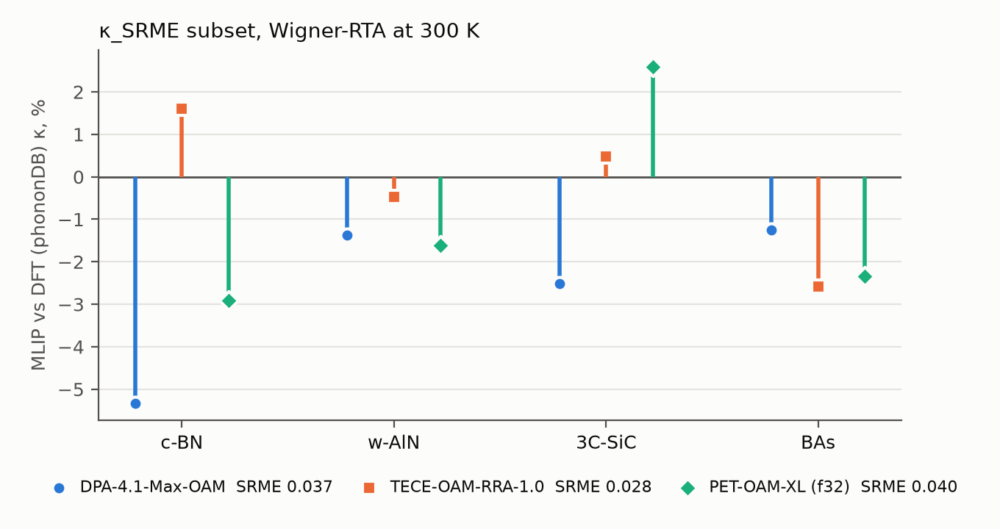
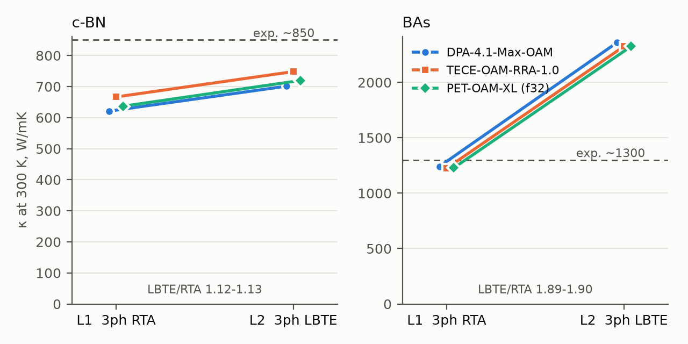

# MLIP × 生成模型 × Agent：高导热材料的可审查工作流

**要回答的问题**：在 MatterGen 生成的多元轻元素结构里，用三声子（3ph）RTA 筛出来的高 κ 候选，换成迭代解（LBTE）、再加上四声子散射（4ph）之后还剩多少？有没有结构在计入 4ph 后仍然超过 c-BN（约 850 W/mK），甚至接近 BAs（约 1300）？

三个组件各管一块：

1. **MatterGen** 在 B–C–N、B–C–P 等轻元素体系里生成数据库以外的候选；
2. **MLIP 委员会**（DPA-4.1-Max-OAM、TECE-OAM-RRA、PET-OAM-XL）让 3ph / LBTE / 4ph 对几十上百个候选都算得起，模型间的分歧也是决策依据；
3. **agent**（Claude Code，通过 MCP 工具）在固定计算预算下决定每个候选升到哪一级保真度，并识别计算伪影。它的表现和「按委员会均值取 top-k」的固定规则、随机选择用同一预算比较。

## 当前进展（2026-11-07，S0 校准）

三个委员会模型都已跑完 c-BN、BAs 的 L1–L3 和 κ_SRME 子集。还没有开始生成候选（S1）。



**κ_SRME 子集**：四个化合物上，三个模型相对 phononDB（DFT）的偏差都在 ±5.5 % 以内，SRME 0.028–0.040。我们的 PET-OAM-XL 结果和排行榜上同一模型的预测相差不超过 2.4 %，说明移植的 κ 协议和排行榜一致（BAs 的 −2.4 % 还在查）。



**L1 → L2**：LBTE 直接解让 c-BN 的 κ 提高 12–13 %，BAs 提高 89–90 %（约 2320 W/mK，实验约 1300）。只算 3ph 时 BAs 的高估是已知现象，四声子散射会把它拉回实验附近（Feng, Lindsay & Ruan, [PRB 96, 161201 (2017)](https://doi.org/10.1103/PhysRevB.96.161201)），这正是 L3 要检查的。

**未解决**：R3m-BNC₂ 的 FC4 拟合在 300 GB 内存下 OOM。

图由 `scripts/readme_figures.py` 从 `runs/s0-calibration/` 的记录和本地结果库生成。

## 流程

| 步骤 | 内容 | 在哪跑 |
|---|---|---|
| S0 校准 | 用 κ_SRME 表里的 c-BN、w-AlN、3C-SiC 检查 MLIP κ 流程；c-BN、BAs、R3m-BNC₂ 走一遍整个阶梯，定出「命中」基准 | GPU 集群 |
| S1 生成 | MatterGen 按化学体系生成，原胞 ≤ 8 原子（配额见文献调研） | GPU 集群 |
| S2 去重 / 新颖性 | 对称性去重，和 MP / Alexandria 比对，剔除 κ_SRME 测试化合物 | 本地 |
| S3 弛豫 + E_hull | MLIP 弛豫，对照 MP 凸包初筛 | GPU 集群 |

S3 之后进入**多保真度阶梯**，每升一级成本大约涨一个数量级：

| 级 | 内容 | 在哪跑 | 工具状态 |
|---|---|---|---|
| L0 | FC2 描述符：虚频、声学–光学 gap、加权相空间、群速度、Grüneisen + Slack 估计 | GPU 集群 | 已有 |
| L1 | 委员会各算 3ph Wigner-RTA κ（κ_SRME 协议），给出模型间分歧；力常数存入缓存 | GPU 集群 | 已有 |
| L2 | LBTE 直接解，读 L1 的力常数缓存，不再调用 MLIP | GPU 集群 | 已有 |
| L3 | MLIP 四阶力常数（随机位移 + symfc）→ ShengBTE / FourPhonon 输入，3+4ph κ | GPU 集群 | 已有 |
| L4 | DFT：**人批准后才提交**。L4a 弛豫 + 带隙；L4b 有限位移 FC2 / FC3 → DFT κ（`phono3py_fd`） | CPU 集群 | 已有 |

另外两项：
- **benchmark**：在 Li/Xia 公开的 773 个化合物四阶力常数上，检验 uMLIP 的 FC4 / 4ph 散射率。
- **附带实验**：用 L4b 的位移超胞力微调 MACE-MPA-0，报告 κ_SRME 前后变化，开始前要人确认。

## 设计原则

- **分工**：工具负责「怎么算」，默认参数都写在工具里，每个都注明出处。agent 负责「算什么、信不信」。
- **记录**：每次调用写一条 JSON 记录，内容包括：
  - 参数和每个参数的来源（默认值，或 agent 覆盖时给出的理由）；
  - 决定由谁做出（`agent` / `human`）；
  - 输入和输出。
- **人工关口**：
  - 提交 VASP 和开始微调之前，agent 必须停下来。
  - 审批只能由人在终端里完成，MCP 里没有任何「批准」类工具。
- **同一口径**：MLIP 的 κ 移植自 κ_SRME 官方实现，包括位移 0.03 Å（委员会三个模型在排行榜上跑 κ 时用的值；`KappaSettings` 默认 0.01，MACE-MPA-0 用的是它）、MS-SMM19、noNAC、phono3py 3.30.0，因此结果能和 Matbench Discovery 排行榜直接比较。
- **防泄漏**：κ_SRME 的 103 个测试条目对应 70 个化学式。这些化学式的所有多形体及其扰动后代，都不能进入训练、回放或调参数据。

## 四个 MCP server

| server | 作用 | 主要工具 |
|---|---|---|
| `mga-structures` | 结构导入、过滤、去重、新颖性和泄漏检查 | `import_structures` `filter_structures` `deduplicate` `check_novelty` `check_benchmark_leakage` |
| `mga-mlip` | MatterGen 生成；MLIP 弛豫、声子和 κ；阶梯 L0 / L2 / L3；收敛检查 | `submit_mattergen` `submit_mlip_relax` `submit_mlip_fc2_descriptors` `submit_mlip_phonon_kappa` `submit_mlip_kappa_lbte` `submit_mlip_fc4_fourphonon` `submit_mlip_convergence` `describe_parameters` |
| `mga-dft` | VASP 输入预览、成本估计、审批单、提交（弛豫、FC2 声子、FC3 + κ） | `preview_vasp_inputs` `estimate_vasp_cost` `request_vasp_submission` `submit_vasp` |
| `mga-analysis` | 作业状态、取回结果、E_hull、κ_SRME、模型分歧；预算账本和升级策略基线 | `job_status` `fetch_results` `compute_ehull` `kappa_srme` `model_disagreement` `kappa_convergence` `budget_ledger` `escalation_baseline` `query_records` |

运行模式用环境变量 `MGA_MODE` 切换：

| 模式 | 提交类工具的行为 |
|---|---|
| `dry_run`（默认） | 构建作业、校验参数、写记录，**不提交** |
| `live` | 通过 jobflow-remote 提交到集群。需要先配好 MongoDB 和 jobflow-remote，见 [plan §7](docs/mcp_servers_plan.md) |
| `replay` | 只返回缓存的结果，用来做可复现的 agent 评估。VASP 不能回放 |

`live` 模式的本地 runner（jobflow-remote 1.0.1，11-06 首次跑通）：

```bash
cp configs/jobflow_remote/mga.yaml.template ~/.jfremote/mga.yaml   # 填 TODO；pre_run 里不能写 # 注释
export PATH=$HOME/.venvs/mga/bin:$PATH   # runner 要找到 supervisord
jf project check --errors
jf admin reset        # 只在全新的空库上做一次：会清空所有作业数据
jf -p mga runner start
```

MongoDB 的数据目录要放在 ext4 上（不要放 /mnt 下的 Windows 盘）。笔记本休眠后 runner 会报 `No route to host`，`jf -p mga runner restart` 即可。

## 安装和测试

```bash
python -m venv ~/.venvs/mga && source ~/.venvs/mga/bin/activate
pip install -e ".[local,test]"   # 本地：MCP server、作业提交、测试
pip install -e ".[worker]"       # 每个集群 worker（包括跑 VASP 的 CPU 集群）：phono3py==3.30.0、phonopy、symfc
python -m pytest                 # 73 个测试，约 4 分钟
```

phono3py 必须用 **3.30.0**：3.31 起删掉了 κ_SRME 用的 MS-SMM19 求解器。

## 和 Claude Code 一起用

1. **在项目根目录启动 `claude`**，四个 server 由 `.mcp.json` 加载。`.mcp.json` 里写的是本机的绝对路径（venv 和项目目录），换机器时要改。
2. 默认是 `dry_run`。要切到 live，用 `MGA_MODE=live claude` 启动。
3. VASP 的审批流程：
   1. agent 调用 `request_vasp_submission`，生成一张审批单后停下。
   2. 人在**另一个终端**里审批（需要交互式终端，还要重新输入审批单 ID，并写一句理由）：
      ```bash
      mga approvals list
      mga approvals show <id>
      mga approvals approve <id>
      ```
   3. 批准后，agent 用 `submit_vasp(approval_id)` 提交。每张审批单只能用一次。

## 已定的计算选择（10-20 定，11-03 更新）

- **DFT**：PBE（PBE_54 PAW），VASP 6.4.2，与 κ_SRME 参考数据的泛函一致；不用 atomate2 默认的 PBEsol。
- **NAC**：先不做。这与 noNAC 的参考数据一致。
- **DFT 力常数**：用有限位移。
  - 位移超胞的力同时用作微调数据。
  - 数据量按 DFT 能力控制：成本估计会给出位移数和计算数，由人在审批时决定。
- **DFT 三阶力常数**：phono3py 有限位移。每一阶自动选系统位移和「随机位移 + symfc 拟合」中较便宜的那种，例如 w-AlN 的 FC3 从 1254 个超胞降到 44 个。位移 0.03 Å，和 MLIP 侧相同。
- **超胞（length_rule_v2，11-07）**：FC3 用保留点群的最小超胞；MLIP 的 FC2 用任意形状的最小超胞（省 GPU 显存），DFT 的 FC2 仍保留点群。
- **超胞收敛**：MLIP 端对所有候选扫超胞大小；DFT 端只抽 1–2 个结构确认。每个 DFT κ 结果都附带截断半径和快照数的收敛诊断。项目内的判据是 κ 变化 < 5%。
- **委员会和目标（11-03）**：委员会换成排行榜靠前、能直接用的模型。目标定为 c-BN / BAs 而不是金刚石。微调降为附带实验。

## 目录

```
src/mga/
  tools/        普通 Python 函数（所有逻辑都在这里）
  mcp_servers/  四个 MCP server（薄 adapter）
  workflows/    κ 协议、MLIP / MatterGen 作业、VASP flow
  analysis/     κ_SRME、E_hull
  specs.py      各计算的参数 schema：默认值、范围、出处
  approvals.py  审批单；cli.py 是人用的 `mga` 命令
tests/          73 个测试
configs/        集群信息、模型列表、jobflow-remote 模板
data/reference/kappa_srme/   κ_SRME 的 103 个参考结构和 κ（只用于测试）
docs/           MCP 规划、文献调研；figures/ 是 README 的图
scripts/        集群安装脚本（FourPhonon 等）、README 作图
runs/           每次工具调用的 JSON 记录（S0 校准的全部记录都在这里）
DESIGN.md       总体设计与时间线
```

运行时还会产生 `approvals/`（审批单）和 `data/results/`（结果库，不进 git）。

## 文档

- [DESIGN.md](DESIGN.md)：问题、流程、参数来源、时间线
- [docs/mcp_servers_plan.md](docs/mcp_servers_plan.md)：工具清单、默认参数及出处、已查证的事实、测试覆盖
- [docs/lit_review.md](docs/lit_review.md)：高 κ 判据、已有工作、MatterGen 化学体系与配额

## 来源

- **参考数据**：`data/reference/kappa_srme/` 中的 103 个结构和 noNAC κ 来自 [phononDB](https://github.com/atztogo/phonondb)（A. Togo），经由 [k_SRME](https://github.com/MPA2suite/k_SRME)（GPL-3.0）取得，具体版本见 `SOURCE.txt`；phononDB 的原始数据放在 NIMS MDR 上（抽查的一条是 CC BY 4.0）。这些数据只用于测试，沿用 k_SRME 的 GPL-3.0。
- **许可证**：代码以 MIT 发布，见 [LICENSE](LICENSE)。
- **κ 协议**：`src/mga/workflows/kappa_protocol.py` 移植自 [matbench-discovery](https://github.com/janosh/matbench-discovery)（MIT，commit `2b7bff9`），而 matbench-discovery 的实现又改编自 k_SRME，见 B. Póta, P. Ahlawat, G. Csányi, M. Simoncelli, [arXiv:2408.00755](https://arxiv.org/abs/2408.00755)。
